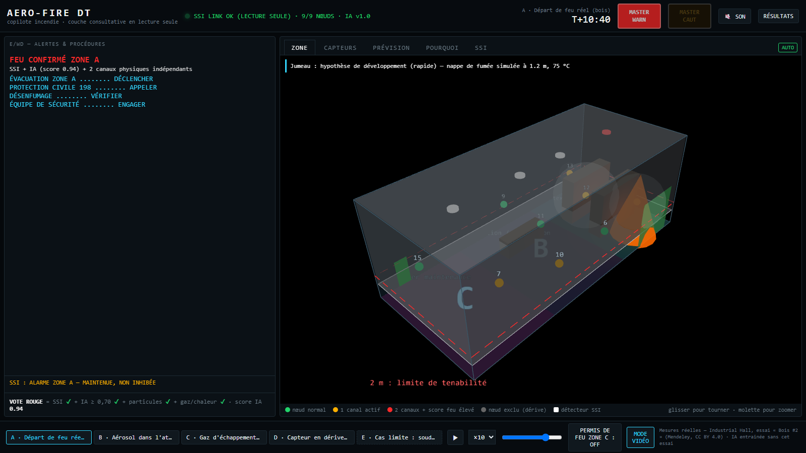

# Aero-Fire DT — copilote incendie pour les usines

> **Un copilote qui lit votre système de sécurité incendie (SSI) sans jamais pouvoir le toucher.**
> Prototype du challenge *Aero-Entrepreneur* — Tunisian Aeroday 2026, en partenariat avec la Protection Civile.



## Le problème
Les alarmes incendie des usines sonnent souvent pour rien (aérosols, poussières, échappement…) : arrêts de production, évacuations inutiles, déplacements des secours. Et quand un vrai feu démarre, l'agent de sécurité voit seulement « ALARME ZONE B », sans savoir si c'est grave ni ce qui va se passer.
En Angleterre, **39 % des interventions des pompiers concernent de fausses alarmes** (année se terminant en septembre 2025) ; dans les soutes d'avions, on comptait **environ 200 fausses alarmes pour 1 feu réel** (NIST SP 965).

## La solution
Une **couche consultative** ajoutée au SSI existant, inspirée des méthodes de l'aéronautique :

| Brique | Ce qu'elle fait | Inspiration aéronautique |
|---|---|---|
| Raccordement **lecture seule** | lit les relais du SSI via optocoupleurs ; aucune voie de retour, l'IA ne peut jamais acquitter, temporiser ni inhiber une alarme | architecture à double chaîne, analyse de sécurité (ARP4761A, transposée) |
| **Vérification d'alarme** | 9 nœuds multi-capteurs (particules, CO, H₂, COV, CO₂, température) + IA « feu ou nuisance ? » | détection multicritère des soutes cargo (recherche FAA) |
| **Vote double boucle** | alerte rouge seulement si SSI + IA + **2 principes physiques indépendants** concordent | détection incendie moteur à double boucle (boucle A ET boucle B) |
| **Prévision 30-60 s** | jumeau numérique (IFC) + modèle de zones + IA de substitution : hauteur de fumée, température, temps avant conditions intenables | — |
| **Écran du poste de sécurité** | cockpit sombre, alertes rouge/ambre, procédures en cyan, MASTER WARN/CAUT, indicateur de vie permanent | philosophie ECAM (Airbus) |
| **Banc d'essai virtuel** | rejoue des scénarios réels de feu et de nuisance dans toute la chaîne logicielle | « iron bird », méthode d'essai AC 25-9A, objectif d'alerte ≤ 60 s inspiré de 14 CFR 25.858 |

**Aucune certification aéronautique n'est revendiquée** : ce sont des méthodes transposées, pas des certificats.

## Résultats mesurés (données réelles, essais jamais vus)
Jeu public *Indoor Fire Dataset with Distributed Multi-Sensor Nodes* — hall industriel 10 × 22 × 8 m (Mendeley, CC BY 4.0). Chaque essai est jugé par un modèle entraîné **sans** cet essai (leave-one-episode-out).

| | IA Aero-Fire DT | Détecteur optique classique |
|---|---|---|
| Feux détectés | **17 / 17** | 17 / 17 |
| Essais de nuisance rejetés | **11 / 15** | 10 / 15 |
| Fausses alarmes du détecteur classique reconnues comme nuisance | **3 / 5** | — |
| Feu confirmé ≤ 60 s après l'alarme SSI | **15 / 17** (avant le SSI : 9 / 17) | — |
| Fausses alertes sur 56,6 h d'activité normale | 1 | 1 |
| **Autre site jamais vu (salle EN 54)** : nuisances rejetées · feux confirmés | **7 / 7 · 12 / 13** | 6 / 7 · 13 / 13 |

Prévision (1 000 feux simulés jamais vus) : **± 0,06 m** sur la hauteur de nappe et **± 6,8 °C** à +60 s (sans IA : ± 0,41 m / ± 34 °C), alerte « intenable dans 60 s » correcte à **96 %**, calcul en **0,14 ms**.

**Limites :** soudure et machine à fumée (1-2 essais seulement) trompent encore l'IA ; positions des nœuds et SSI simulés ; les feux d'essai sont naissants, leur croissance est une hypothèse du modèle de zones. Le gain réel sera mesuré pendant un pilote de 90 jours.

## Démarrer
```bash
pip install -r requirements.txt
python scripts/run_all.py        # télécharge les données, entraîne, évalue, construit, teste (~4 min)
```
Puis ouvrir **`app/index.html`** (double-clic, fonctionne hors ligne dans Chrome / Edge / Firefox).
- Scénarios : **A** feu réel · **B** aérosol (fausse alarme SSI) · **C** échappement (CO) · **D** capteur en dérive · **E** cas limite soudure.
- Bouton **MODE VIDÉO** : visite guidée de 55 s avec sous-titres (pour l'enregistrement de la vidéo).
- Bouton **RÉSULTATS** : tous les chiffres mesurés.

Démonstration du raccordement lecture seule (Modbus) :
```bash
python edge/panel_sim.py          # SSI simulé (rejoue le feu réel)
python edge/gateway.py            # passerelle : lit en FC03 uniquement, toute écriture est refusée
```

## Structure
```
ai/common/          chargement des données, caractéristiques causales
ai/alarm_verifier/  vérification feu/nuisance, vote double boucle, évaluation honnête
ai/forecast/        modèle de zones (physique), 5 000 scénarios, IA de substitution
twin/               jumeau IFC du hall (IfcOpenShell) → JSON
scenarios/          scénarios du tableau de bord à partir des mesures réelles
app/                tableau de bord ECAM (HTML/JS, Three.js en local)
edge/               SSI simulé + passerelle Modbus lecture seule
tests/              tests physiques, JS = Python, passerelle lecture seule
tools/              vérification du tableau de bord dans Chrome sans écran + captures
docs/               résultats, captures, dossier de sécurité, explications pour l'équipe
```
Documents : [rapport du modèle](docs/AI_Model_Report.md) · [dossier de sécurité](docs/safety/Safety_Case.md) · [comment ça marche](docs/COMMENT_CA_MARCHE.md).

## Données et licences
- Code : licence MIT (voir `LICENSE`). Three.js r149 : MIT.
- Données (non redistribuées, téléchargées par `scripts/download_data.py` avec contrôle SHA-256), **CC BY 4.0** :
  *Indoor Fire Dataset with Distributed Multi-Sensor Nodes — Industrial Hall*, Mendeley Data, DOI [10.17632/yghykzm4km.1](https://data.mendeley.com/datasets/yghykzm4km/1) ;
  salle d'essai EN 54, Mendeley Data, DOI [10.17632/npk2zcm85h](https://data.mendeley.com/datasets/npk2zcm85h/1).
- Ce prototype n'est **pas** un système de détection certifié. Le SSI certifié (EN 54 / NFPA 72) reste la barrière de sécurité.

---
### English summary
Aero-Fire DT is an advisory, read-only layer on top of a factory's certified fire alarm panel. It verifies alarms with multi-sensor fusion and a dual-loop voting rule borrowed from aircraft engine fire detection, forecasts smoke conditions 30-60 s ahead with a physics-trained surrogate, and presents everything on an ECAM-inspired operator display. Evaluated on a public real-fire dataset with leave-one-episode-out validation: 17/17 fires detected, 11/15 nuisance runs rejected (classic optical detector: 10/15), 7/7 nuisances rejected on an unseen second site. Run `python scripts/run_all.py`, then open `app/index.html`.
