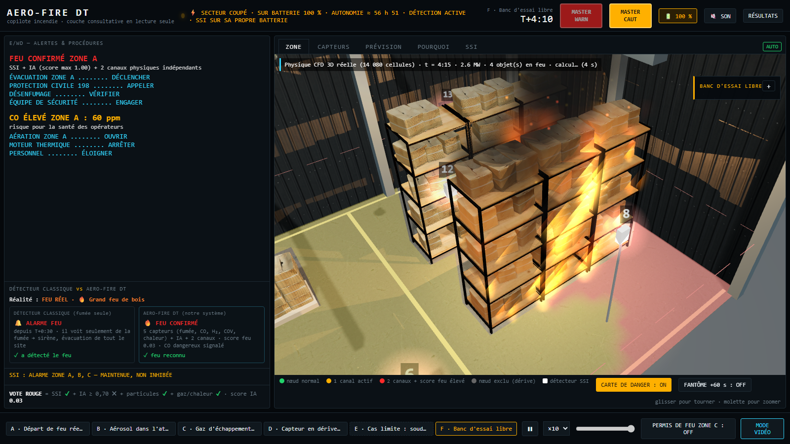

# Aero-Fire DT — copilote incendie pour les usines

> **Un copilote qui lit le système de sécurité incendie (SSI) d'une usine sans jamais pouvoir le toucher, et qui dit à l'agent de sécurité : « vrai feu ou fausse alarme ? que faire ? que va-t-il se passer dans 60 s ? »**
> Prototype du challenge *Aero-Entrepreneur* — Tunisian Aeroday 2026, en partenariat avec la Protection Civile.



**Essayer tout de suite :** télécharger ou cloner le dépôt, puis **double-cliquer sur `app/index.html`** (Chrome, Edge ou Firefox). Aucune installation, aucun Internet nécessaire.

---

## Sommaire
1. [Essayer l'application (mode d'emploi)](#1-essayer-lapplication-mode-demploi)
2. [Le problème](#2-le-problème)
3. [La solution en une image](#3-la-solution-en-une-image)
4. [Comment ça marche, étape par étape](#4-comment-ça-marche-étape-par-étape)
5. [Les données utilisées](#5-les-données-utilisées)
6. [Le modèle IA et l'apprentissage local](#6-le-modèle-ia-et-lapprentissage-local)
7. [Résultats mesurés](#7-résultats-mesurés)
8. [L'application (tableau de bord)](#8-lapplication-tableau-de-bord)
9. [Physique 3D réelle (CFD) et banc d'essai libre](#9-physique-3d-réelle-cfd-et-banc-dessai-libre)
10. [Matériel, énergie et coupures de courant](#10-matériel-énergie-et-coupures-de-courant)
11. [Sûreté et lien avec l'aéronautique](#11-sûreté-et-lien-avec-laéronautique)
12. [Ce qui est réel, simulé, ou à venir](#12-ce-qui-est-réel-simulé-ou-à-venir)
13. [Reproduire tous les résultats](#13-reproduire-tous-les-résultats)
14. [Structure du dépôt](#14-structure-du-dépôt)
15. [Données, licences, crédits](#15-données-licences-crédits)

---

## 1. Essayer l'application (mode d'emploi)
**Ouvrir :** bouton vert **Code → Download ZIP** sur GitHub (ou `git clone`), décompresser, puis **double-cliquer sur `app/index.html`** (Chrome ou Edge sur ordinateur). Rien à installer, pas besoin d'Internet.

**Les commandes**

| Où | Bouton | À quoi ça sert |
|---|---|---|
| Bas de l'écran | **A … E** | rejouer un scénario enregistré (mesures réelles) |
| Bas de l'écran | **F · Banc d'essai libre** | créer **vos propres** tests (voir plus bas) |
| Bas de l'écran | **▶**, vitesse **×10**, curseur | lecture / pause, accélérer, aller à un instant précis |
| Bas de l'écran | **MODE VIDÉO** | visite guidée automatique de 55 s (idéale pour une démo) |
| Bas de l'écran | **PERMIS DE FEU ZONE C** | soudure autorisée en zone C : alertes IA masquées là-bas, alarmes SSI jamais masquées |
| Haut de l'écran | **⚡ COUPURE** | simule une coupure STEG : passage sur batterie, la détection continue |
| Haut de l'écran | **SON** · **RÉSULTATS** | signaux sonores · tableau des résultats mesurés |
| Onglets | **ZONE · CAPTEURS · PRÉVISION · POURQUOI · SSI** | usine 3D · courbes · fumée à +60 s · ce qui a compté pour l'IA · état de la centrale |
| Vue 3D | glisser / molette | tourner / zoomer ; **CARTE DE DANGER** et **FANTÔME +60 s** |

**Les scénarios (A à E : mesures réelles rejouées)**

| Scénario | Ce qui se passe | Ce qu'il faut regarder |
|---|---|---|
| **A** Feu réel (bois) | un feu démarre doucement | « feu couvant possible » à 3 min 30, pré-alarme à 6 min 30, le détecteur classique sonne seulement à 10 min 10 |
| **B** Aérosol | un spray déclenche le SSI pour rien | le détecteur classique fait évacuer tout le site ; notre écran : « APPLIQUER LA PROCÉDURE » + indices de nuisance → un agent vérifie la zone |
| **C** Échappement | un chariot thermique tourne | pas de feu, mais **CO dangereux** signalé |
| **D** Capteur en dérive | un capteur tombe en panne (défaut injecté) | le capteur passe en noir et sort du vote |
| **E** Soudure | soudure dans l'atelier | cas difficile : l'IA se trompe encore, c'est l'humain qui tranche |

**Le banc d'essai libre (scénario F) : faites vos propres tests**
1. Cliquez sur **F · Banc d'essai libre** : le hall est vide et la physique 3D tourne en direct.
2. Dans le panneau, choisissez une **source** :
   - feux : cigarette, bougies, petit / grand feu de bois, balle de textile, plastiques ;
   - nuisances : aérosol, soudure, échappement de chariot, poussière de découpe.
3. **Cliquez sur le sol** du hall pour la poser. Réglez l'**intensité** (×0,25 à ×3) si vous voulez.
4. Regardez la fumée et les gaz se déplacer, les capteurs changer de couleur, et la fenêtre **« Détecteur classique vs Aero-Fire DT »** qui dit en direct qui a raison.
5. **↺ RÉINITIALISER** vide le hall ; **–** réduit le panneau ; changer de scénario nettoie la scène tout de suite.

Idées de tests : un grand feu de bois près des étagères (→ **FEU CONFIRMÉ**, le feu se propage aux racks) ; un aérosol sous un capteur (→ le SSI sonne, l'écran demande une levée de doute) ; un échappement (→ **CO ÉLEVÉ**) ; une bougie loin des capteurs (→ rien, comme dans la réalité).
Les capteurs du banc sont **calculés par la physique** ; c'est la **même IA** que pour les scénarios réels.

Couleurs des capteurs : 🟢 normal · 🟡 un seul canal actif · 🔴 deux canaux + score élevé · ⚫ exclu.

## 2. Le problème
- Les alarmes incendie des usines sonnent souvent **pour rien** (aérosols, poussière, échappement, soudure, vapeur…) : évacuations inutiles, production arrêtée, secours déplacés. En Angleterre, **39 % des interventions des pompiers concernent de fausses alarmes** (année se terminant en septembre 2025) ; dans les soutes d'avions, on comptait **environ 200 fausses alarmes pour 1 feu réel** (NIST SP 965).
- Quand un vrai feu démarre, l'agent voit seulement « ALARME ZONE B », sans savoir si c'est grave ni ce qui va arriver.
- Un détecteur classique ne regarde **que la fumée** : il ne peut pas distinguer un spray d'un feu.

## 3. La solution en une image
```
 Boîtiers capteurs (9 dans le hall)          Passerelle (petit ordinateur local)            Écran du gardien
 fumée · CO · H2 · COV · CO2 · T° · HR  ──►  IA + vote de sécurité + prévision 60 s   ──►  alertes type cockpit
                                              ▲                                              + vue 3D
 SSI certifié (alarme incendie existante) ────┘  LECTURE SEULE : on lit, on ne commande jamais
```
- **On n'enlève rien** : le SSI certifié reste la barrière de sécurité. Aero-Fire DT ajoute un **deuxième avis**.
- **Fonctionne sans Internet** et **sur batterie** en cas de coupure STEG.

## 4. Comment ça marche, étape par étape
Toutes les **10 secondes** :

| # | Où | Ce qui se passe |
|---|---|---|
| 1 | Boîtier | Lit **11 mesures** : particules (petites, moyennes, total, taille moyenne), CO, H₂, COV, CO₂, température, humidité |
| 2 | Boîtier | Apprend son **air normal** (niveau bas des 30 dernières minutes) et ne regarde que les **hausses** |
| 3 | Boîtier | Calcule **19 indices** : hausses, vitesse de hausse sur 60 s, taille des particules, « gaz par fumée », « COV par fumée » |
| 4 | Boîtier | Le **modèle IA** (300 petits arbres de décision) donne un **score de feu de 0 à 1** |
| 5 | Boîtier | 3 vérifications simples (sans IA) : **canal A** fumée, **canal B** gaz (CO, H₂ ou COV), **canal C** chaleur |
| 6 | Passerelle | Prend les 3 boîtiers les plus actifs, moyenne et lisse leurs scores → **score du hall** |
| 7 | Passerelle | **Décide** (règle de sécurité ci-dessous) et lit l'état du SSI |
| 8 | Écran | Affiche l'alerte, la zone, les actions, la prévision à 60 s |

**Règle de décision (le « verrou de sécurité »)**

| Verdict | Condition |
|---|---|
| ⚠ **FEU COUVANT POSSIBLE** | score ≥ 0,70 + fumée ou gaz encore en hausse, pendant 30 s → « envoyer quelqu'un vérifier » |
| 🔥 **FEU** | score ≥ 0,70 **ET 2 signes physiques différents** (fumée + gaz, ou fumée + chaleur) **pendant 30 s** → reste verrouillé jusqu'à acquittement humain |
| ✋ **NUISANCE** | score ≤ 0,30 pendant 30 s |
| ? **INCERTAIN** | entre les deux |

Combiné avec le SSI : SSI + FEU → **FEU CONFIRMÉ** (évacuer, appeler 198) · FEU sans SSI → **PRÉ-ALARME** · SSI + indices de nuisance → **ALARME SSI : APPLIQUER LA PROCÉDURE** + « indices compatibles avec une nuisance », **sans score affiché** (levée de doute ciblée, l'alarme SSI n'est **jamais** inhibée) · CO élevé → **CO ÉLEVÉ** · capteur incohérent → **exclu du vote**.

**Exemple réel (scénario A, feu de bois enregistré)** : 3 min 30 « feu couvant possible » → 6 min 30 pré-alarme → 10 min 10 le détecteur classique sonne enfin → « FEU CONFIRMÉ ».

## 5. Les données utilisées
| # | Jeu de données | Contenu | Utilisation |
|---|---|---|---|
| 1 | **Mendeley « Industrial Hall »** (Allemagne, CC BY 4.0) | 9 boîtiers multi-capteurs, 1 mesure / 10 s, **248 502 lignes, 77 h**. **32 essais réels** : 17 feux (bois, bougies, câbles, mèches) et 15 nuisances (déodorant, échappement, machine à fumée, CO, éthanol, soudure, découpe, déchets verts) + ≈ 50 h d'activité normale | **Entraînement** + évaluation honnête |
| 2 | **Mendeley « salle EN 54 »** (même laboratoire, autre salle) | 13 feux, 7 nuisances | **Test uniquement** (autre site) |
| 3 | **NIST FR 4019** (USA, domaine public) | 8 petits feux, 33 nuisances (cuisine, cigarettes, bougie), **capteurs différents** | Test indépendant + **exemple de « nouvelle usine »** pour l'apprentissage local |
| 4 | Données simulées (nos modèles physiques) | 5 000 feux simulés, CFD | Prévision de fumée et banc d'essai **uniquement** — jamais pour entraîner l'IA feu/nuisance |

**Exemple de ce que voit l'IA (vraies lignes du jeu 1)**

| | 🔥 Feu de bois | 💨 Spray déodorant | 🚜 Échappement |
|---|---|---|---|
| Particules | 6 252 (beaucoup) | 1 517 | 40 |
| Taille des particules | **0,51 µm (fines = fumée)** | **1,03 µm (grosses = gouttelettes)** | 0,44 |
| Hausse CO | +1,9 ppm | +0,3 | **+41 ppm** |
| Hausse COV | +5 | **+18,7** | +4,6 |

Un détecteur classique sonne pour le spray ; l'IA voit « grosses particules + COV + pas de CO = spray ».

**Règle d'évaluation partout :** chaque essai est jugé par un modèle qui **ne l'a jamais vu** (on retire un essai, on entraîne sur les autres, on juge, on recommence).

## 6. Le modèle IA et l'apprentissage local
- **Ce qu'est le modèle** : un « gradient boosting » de **300 arbres de décision** (scikit-learn). Entrée : 19 indices d'un boîtier. Sortie : un score de feu entre 0 et 1. Calcul ≈ 2 ms. Choisi parce qu'il apprend bien avec peu d'essais, est rapide et **explicable** (onglet POURQUOI). Pas de YOLO : YOLO traite des images, nos données sont des mesures de capteurs.
- **Le score ne décide jamais seul** : la règle de sécurité à 2 canaux a toujours le dernier mot.
- **Modèle général** : appris sur tous les sites connus (aujourd'hui le hall industriel). C'est ce que reçoit une nouvelle usine le **jour 1**.
- **Modèle local (un par usine)** : données générales + enregistrements de l'usine pendant le **pilote de 90 jours** (les réponses du gardien après chaque levée de doute servent d'étiquettes), réentraînés ensemble.
- **Ce que montre le test NIST** : ce sont les **données du site** qui font le travail (avec ou sans le modèle général : 29 / 33). D'où la règle : chaque usine commence par un pilote de 90 jours sous la centrale certifiée.

| Fichier | Rôle |
|---|---|
| `ai/alarm_verifier/results/model.pkl` et `app/data/verifier_data.js` | Modèle de démonstration (19 indices) utilisé par l'application et tous les résultats principaux |
| `models/general_model.pkl` | Modèle **général** (7 indices disponibles sur NIST) |
| `models/local_model_NIST.pkl` | Modèle **local** de l'usine-exemple NIST |
| `models/models_card.json` | Carte d'identité des deux modèles (données, résultats) |
| `ai/external_test/site_adaptation.py` → `train_site_model()` | Le mécanisme d'apprentissage local |

**Prévision à +60 s** : petit réseau de neurones (MLP 64 × 64) entraîné sur 5 000 feux simulés par un modèle de zones (même famille que CFAST du NIST).

## 7. Résultats mesurés
**Vérification d'alarme — hall industriel (essais jamais vus)**

| | IA Aero-Fire DT | Détecteur classique (fumée seule) |
|---|---|---|
| Feux détectés | **17 / 17** | 17 / 17 |
| Nuisances rejetées | **11 / 15** (IC 95 % ≈ 48–89 %) | 10 / 15 |
| Fausses alarmes du détecteur reconnues comme nuisance | **3 / 5** | — |
| Feu confirmé ≤ 60 s après le SSI | **15 / 17** (avant le SSI : 9 / 17) | — |
| Fausses alertes sur 49,9 h d'activité normale (fenêtre de référence 30 min) | 0 | 1 |
| Alerte précoce « feu couvant possible » | **17 / 17 feux**, avant un seuil optique standard dans 10 cas ; 2 / 15 nuisances | — |
| Type de scénario entier jamais vu (test sévère) | 15 / 17 feux, 10 / 15 nuisances | — |
| **Autre salle (EN 54)** | **12 / 13 feux, 7 / 7 nuisances** | 13 / 13 · 6 / 7 |

**Nouveau site (NIST, USA) : apprentissage local**

| | Feux | Fausses alarmes de cuisine NON appelées feu |
|---|---|---|
| Modèle général seul (jour 1) | 7 / 8 | **6 / 33** |
| **Après apprentissage sur les données du site** | **8 / 8** | **29 / 33** (fausses alarmes : 27 → 4) |
| Données du site seules, sans le modèle général | 8 / 8 | 29 / 33 |
| Pilote court (30 % des essais locaux) | 74 % en moyenne | 88 % en moyenne |
| Usine d'origine après apprentissage local (pas d'oubli) | 17 / 17 | 9 / 15 (avant : 10 / 15) |

**Prévision (1 000 feux simulés jamais vus)** : ± 0,06 m sur la hauteur de fumée et ± 6,8 °C à +60 s (sans IA : ± 0,41 m / ± 34 °C), alerte « intenable dans 60 s » correcte à 96 %, calcul en 0,14 ms.

Détails : [`docs/AI_Model_Report.md`](docs/AI_Model_Report.md), [`docs/results/`](docs/results/).

## 8. L'application (tableau de bord)
Ouvrir `app/index.html`.

| Zone de l'écran | Rôle |
|---|---|
| Barre du haut | lien SSI (lecture seule), horloge, **MASTER WARN / MASTER CAUT**, **⚡ COUPURE** (simule une coupure de courant), son, résultats |
| Gauche | alertes et actions à faire · fenêtre **« Détecteur classique vs Aero-Fire DT »** (qui a raison, en direct) · ligne de vote |
| Onglets | **ZONE** (usine 3D, fumée, carte de danger) · **CAPTEURS** (courbes) · **PRÉVISION** (+60 s) · **POURQUOI** (indices qui ont compté) · **SSI** |
| Bas | scénarios, lecture / pause, vitesse, curseur de temps, **MODE VIDÉO** (visite guidée de 55 s) |

Couleurs des capteurs : 🟢 normal · 🟡 un seul canal actif · 🔴 deux canaux + score élevé · ⚫ exclu.

## 9. Physique 3D réelle (CFD) et banc d'essai libre
- **Solveur de mécanique des fluides 3D** dans le navigateur (`app/js/cfd.js`) : 14 080 cellules de 50 cm, flottabilité, transport de la chaleur, fumée, CO, CO₂, H₂, COV, grosses particules ; **propagation du feu** d'un objet à l'autre (rayonnement + convection) ; carte de danger à 1,8 m ; prévision « fantôme » à +60 s.
- Vérifié contre des formules d'ingénierie incendie reconnues : panache (Heskestad), jet sous plafond (Alpert), conservation de la masse, ouvertures, hauteur de flamme (`tests/test_cfd.js`).
- **Rendu** : boîtes posées sur les vraies étagères (« gravité »), objets qui noircissent et rougeoient en brûlant, flammes qui montent le long des racks, toit en bac acier, fumée volumique — contrôlé par `tests/test_scene_integrity.js` (0 boîte flottante sur 94).
- **Banc d'essai libre (scénario F)** : cigarette, bougies, petit / grand feu de bois, textile, plastiques ; aérosol, soudure, échappement, poussière. La physique transporte fumée et gaz jusqu'aux capteurs (capteurs **synthétiques**), puis la **même IA** décide. Matrice automatique : gros feux confirmés, aucune nuisance confirmée comme feu, bougie/cigarette loin des capteurs non détectées (réaliste). Test qualitatif, pas une validation.

## 10. Matériel, énergie et coupures de courant
- **Kit standard identique dans chaque usine** (composants du commerce, nous ne fabriquons pas de capteurs) : particules, CO électrochimique, H₂, COV, CO₂, température/humidité, microcontrôleur basse consommation ; une **passerelle** locale (type Raspberry Pi) ; une tablette pour le gardien.
- **Où tourne quoi** : indices + score dans chaque boîtier (le modèle à arbres est assez léger pour un microcontroller) ; vote, prévision et écran sur la passerelle ; la CFD sur la passerelle/l'écran.
- **Énergie** (`docs/ENERGIE.md`, `python scripts/energy_budget.py`) : ≈ 0,63 W par boîtier, ≈ **20 W** pour tout le hall. Batterie LiFePO4 100 Ah → **≈ 57 h** (≈ 28 coupures STEG de 2 h) ; panneau solaire 150 W en option = autonomie illimitée. Pas besoin d'Internet.

## 11. Sûreté et lien avec l'aéronautique
| Aéronautique | Dans Aero-Fire DT |
|---|---|
| Détection incendie moteur à **double boucle** (A et B doivent être d'accord) | Règle des **2 canaux physiques** avant « feu » |
| Écran **ECAM** (Airbus) : cockpit sombre, alertes rouge/ambre, check-lists | Écran du gardien, MASTER WARN / CAUT |
| **« Iron bird »** : banc d'essai au sol avant le vol | Banc d'essai libre et scénarios rejoués |
| **CFD** (outil de base de l'aéronautique) | Fumée simulée en 3D |
| Système certifié indépendant + aide consultative | Lecture seule, le SSI garde la priorité ; dossier de sécurité `docs/safety/Safety_Case.md` |

**Aucune certification aéronautique n'est revendiquée** : méthodes « inspirées de », pas des certificats. Le SSI certifié (EN 54 / NFPA 72) reste la barrière de sécurité.

## 12. Ce qui est réel, simulé, ou à venir
| ✅ Réel et fonctionnel | ⚠️ Simulé | ❌ À venir |
|---|---|---|
| IA sur mesures réelles, vote, alerte précoce | Le **SSI** (le jeu de données n'a pas de vraie centrale) ; la dérive du capteur du scénario D (défaut injecté) | Boîtiers capteurs physiques et passerelle réelle |
| Tableau de bord complet, hors ligne | Les capteurs du **banc d'essai F** (calculés par la physique) | Modèle local intégré dans l'application |
| CFD 3D vérifiée, banc d'essai | La batterie (chiffres des fiches techniques) | IA sur microcontrôleur |
| Apprentissage local testé sur NIST, fichiers des modèles | | Pilote de 90 jours en usine |

## 13. Reproduire tous les résultats
```bash
pip install -r requirements.txt
python scripts/run_all.py          # télécharge les données (SHA-256 vérifié), entraîne, évalue, construit, teste
cd tools && npm install && cd ..   # (optionnel) pour les tests navigateur et les captures (playwright-core + Chrome)
```
Expériences supplémentaires :
```bash
python -I ai/external_test/nist_fr4019.py all           # test indépendant NIST (télécharge ~57 Mo)
python -I -m ai.external_test.site_adaptation           # général vs local
python -I -m ai.external_test.site_forgetting           # l'usine d'origine n'est pas oubliée
python -I -m ai.external_test.build_site_models         # enregistre models/general_model.pkl et local_model_NIST.pkl
python scripts/energy_budget.py                         # bilan énergie et batterie
python edge/panel_sim.py & python edge/gateway.py       # démo du raccordement Modbus en lecture seule
```

## 14. Structure du dépôt
```
app/                 tableau de bord (ouvrir index.html) — js/cfd.js physique 3D, js/sandbox.js banc d'essai,
                     js/verifier.js IA dans le navigateur, data/*.js données embarquées (fonctionne hors ligne)
ai/common/           lecture des données, calcul des 19 indices
ai/alarm_verifier/   modèle feu/nuisance, vote à 2 canaux, évaluation honnête, alerte précoce, export JS
ai/forecast/         modèle de zones + prévision par réseau de neurones
ai/external_test/    test NIST, apprentissage local, fichiers des modèles général/local
ai/data_audit/       audit de la qualité des données
models/              general_model.pkl, local_model_NIST.pkl, models_card.json
scenarios/           construction des scénarios A–E à partir des mesures réelles
twin/                jumeau numérique du hall (IFC)
edge/                SSI simulé + passerelle Modbus lecture seule
tests/               physique, CFD, IA JS = Python, banc d'essai, intégrité de la scène 3D, lecture seule
tools/               captures d'écran et vérifications dans Chrome
docs/                rapport IA, dossier de sécurité, énergie, explications équipe, résultats, captures, livrables
scripts/             run_all.py (tout reproduire), énergie, téléchargement des données
```
Documents : [rapport du modèle IA](docs/AI_Model_Report.md) · [comment ça marche (équipe)](docs/COMMENT_CA_MARCHE.md) · [énergie](docs/ENERGIE.md) · [dossier de sécurité](docs/safety/Safety_Case.md) · [apprentissage local](docs/results/site_adaptation.md) · [test NIST](docs/results/nist_fr4019.md) · [audit des données](docs/results/data_audit.md).

## 15. Données, licences, crédits
- **Code** : licence MIT (`LICENSE`). Three.js r147 + GLTFLoader : MIT.
- **Modèles et textures 3D** : Poly Haven, licence CC0 (liste : `app/data/ASSETS_CREDITS.md`).
- **Données** (non redistribuées, téléchargées par les scripts avec contrôle SHA-256) :
  - *Indoor Fire Dataset with Distributed Multi-Sensor Nodes — Industrial Hall*, Mendeley Data, DOI [10.17632/yghykzm4km.1](https://data.mendeley.com/datasets/yghykzm4km/1), CC BY 4.0 ;
  - salle d'essai EN 54, Mendeley Data, DOI [10.17632/npk2zcm85h](https://data.mendeley.com/datasets/npk2zcm85h/1), CC BY 4.0 ;
  - NIST FR 4019 (Cleary 2003), *Alarm Response to Nuisance Sources*, [nist.gov](https://www.nist.gov/node/437741), domaine public (USA).
- Ce prototype n'est **pas** un système de détection certifié.

---
### English summary
Aero-Fire DT is a read-only advisory layer on top of a factory's certified fire alarm panel. Each sensor node (particles, CO, H2, VOC, CO2, temperature, humidity) computes 19 causal features every 10 s; a 300-tree gradient-boosting model scores "fire vs nuisance", and a dual-channel voting rule inspired by aircraft engine fire detection confirms a fire only when two independent physical signals agree for 30 s. Leave-one-episode-out on a public real-fire dataset: 17/17 fires, 11/15 nuisance runs rejected (optical detector 10/15), early smoulder caution on 17/17 fires; unseen second room 12/13 fires, 7/7 nuisances. On an independent site (NIST FR 4019), training on that site's own data cut cooking false alarms from 27/33 to 4/33, which is why every site starts with a 90-day pilot. While the certified panel is in alarm, the screen shows the procedure and never a confidence score. Includes a real-time 3D CFD solver, a free-test bench, an ECAM-style dashboard, offline operation and battery backup sizing. Open `app/index.html` to try it.
