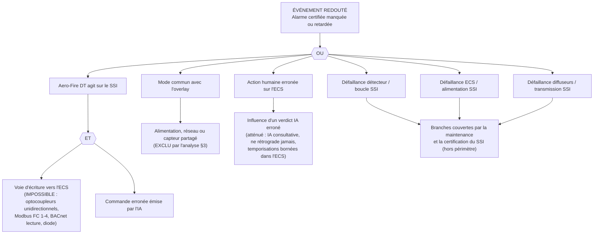

# Dossier de sécurité — Aero-Fire DT (méthode transposée de l'aéronautique)

## 0. Positionnement

> « Aero-Fire DT ne revendique aucune certification aéronautique. Le projet transpose au risque incendie industriel des méthodes éprouvées de l'aéronautique civile (exigences de performance, évaluation de la sécurité, philosophie d'alarme) afin d'en hériter la rigueur. Le système de détection réglementaire du site reste la barrière de sécurité principale ; la couche Aero-Fire DT est une aide à la décision qui s'ajoute à lui. »

> « Aero-Fire DT ne fait pas partie du SSI. Il s'y raccorde en lecture seule, par des sorties relais ou une passerelle constructeur, à travers une isolation galvanique, sans aucune voie de retour. Le raccordement est réalisé par l'installateur agréé du SSI et consigné dans la matrice de mise en sécurité et le dossier de sécurité. Les temporisations éventuelles restent paramétrées dans l'ECS certifié ; l'IA ne fait qu'éclairer l'opérateur pendant la levée de doute. »

| Référence | Usage dans ce dossier |
|---|---|
| CS / 14 CFR 25.858 ([LII](https://www.law.cornell.edu/cfr/text/14/25.858)) | **Objectif de performance** : indication visuelle à l'opérateur ≤ 1 min après le début du feu, test de chaque voie, efficacité dans toutes les configurations. *Aucune exigence de fausse alarme dans ce texte.* |
| NIST SP 965 (2001) ([NIST](https://www.nist.gov/node/586796)) | Soutes : ≈ 200 fausses alarmes de fumée pour 1 réelle |
| FAA, recherche multicritère ([FAA 07-58](https://fire.tc.faa.gov/pdf/07-58.pdf)) | Fumée + température + CO/CO₂ réduisent les fausses alarmes et accélèrent la détection |
| SAE ARP4761A (2023) ([SAE](https://saemobilus.sae.org/standards/arp4761a-guidelines-conducting-safety-assessment-process-civil-aircraft-systems-equipment)) | FHA, FTA, AMDE, analyse des modes communs ; gravités **qualitatives**, **pas** d'objectif 10⁻⁹ |
| DO-178C | Rigueur pour le logiciel **classique** uniquement (acquisition, vote, IHM) |
| Concept Paper IA EASA Issue 2 ([EASA](https://www.easa.europa.eu/en/document-library/general-publications/easa-artificial-intelligence-concept-paper-issue-2)) | IA visée **niveau 1** (assistance à l'humain), assurance de l'apprentissage, explicabilité ; ED-324 / ARP6983 en veille (projet) |
| Détection moteur double boucle ([US 5,172,099](https://image-ppubs.uspto.gov/dirsearch-public/print/downloadPdf/5172099)) | Logique de vote A ET B, mode dégradé signalé |
| ECAM ([Airbus via ICAO](https://www2023.icao.int/ESAF/Documents/meetings/2017/AFI%20FOSAS%202017/Day%201%20Docs/Day_1_2_Airbuspihlo.pdf)) | Cockpit sombre, niveaux rouge / ambre, indicateur de vie permanent |
| AC 25-9A ([FAA](https://www.faa.gov/sites/faa.gov/files/2022-11/AC25-9A.pdf)) | **Méthode** d'essai : sources reproductibles, positions défavorables, chronométrage depuis l'allumage, chaque configuration de ventilation |
| EN 54-13 / NFPA 72 | Aero-Fire DT = « autre système » qui ne doit pas affecter les composants du SDI ; équipement supplémentaire dont un défaut unique (ouverture, terre, court-circuit) ne doit pas affecter la fonction requise (clause NFPA citée par des sources secondaires, à vérifier avant citation) |

## 1. Analyse fonctionnelle des dangers (FHA)

| Fonction | Condition de défaillance | Effet | Gravité (qualitative, transposée) | Atténuation par l'architecture |
|---|---|---|---|---|
| Détecter un feu et alerter | **Non-détection ou détection tardive** (perte de fonction) | Feu non combattu, personnes exposées | **Catastrophique** | Fonction portée par le **SSI certifié**, canal indépendant et plus simple ; Aero-Fire DT n'a aucune voie d'action sur lui |
| Détecter un feu et alerter | **Fausse alarme** (fonction erronée) | Arrêt de production, évacuation (risque de blessures), lassitude d'alarme | **Majeure** | Vérification multicritère proposée à l'opérateur pendant la levée de doute ; la décision reste humaine, sur l'ECS |
| Aide à la décision IA | **Défaillance IA** : verdict faux, absent ou figé | **Perte d'information consultative seulement** ; l'alarme SSI suit son cours normal | Mineure (consultative) | Indicateur de vie permanent ; perte → ambre silencieux ; l'IA ne peut ni acquitter, ni réarmer, ni réduire au silence, ni inhiber, ni prolonger une temporisation |
| Aide à la décision IA | Verdict « nuisance » erroné sur un vrai feu | L'opérateur pourrait hésiter | Majeure (à maîtriser) | L'IA ne rétrograde jamais une alarme SSI ; affichage « consultatif » ; temporisations bornées dans l'ECS (PAS NFPA 72 : acquittement 15 s, investigation ≤ 180 s ; EN 54-2 : plafond total ≈ 10 min selon les constructeurs) ; 2e détecteur ou déclencheur manuel = alarme générale |
| Escalade | Escalade intempestive (appel anticipé de l'équipe de sécurité) | Dérangement | Mineure | Seule action autorisée, dans le sens de la sécurité |

## 2. Arbre de défaillances : l'IA ne peut pas causer une alarme certifiée manquée

**Lecture :** la branche E exige simultanément une commande erronée **et** une voie d'écriture ; la voie d'écriture n'existe pas physiquement (porte ET avec un événement impossible). La branche F est fermée par l'analyse des modes communs. La seule influence résiduelle de l'IA passe par l'opérateur (D1), atténuée par la conception de l'IHM et par les temporisations bornées de l'ECS.

## 3. Analyse des modes communs (CCA)

| Ressource | SSI | Aero-Fire DT | Partage ? | Mesure |
|---|---|---|---|---|
| Alimentation | Alimentation et batteries de l'ECS | Alimentation propre (secteur + onduleur dédié) | **Non** | Interdiction de prélever sur le 24 V / les batteries du SSI |
| Réseau | Boucles de détection, bus constructeur | Réseau OT séparé (VLAN dédié), LoRaWAN/Wi-Fi des nœuds | **Non** | Passerelle de lecture derrière diode ou pare-feu ; référentiel IEC 62443 (cité par son nom) |
| Capteurs | Détecteurs EN 54 sur les boucles | Nœuds capteurs propres (PM, CO, H₂, COV, CO₂, T), caméra optionnelle | **Non** | Aucun détecteur SSI n'est réutilisé ni recâblé |
| Interface | Relais libres / passerelle constructeur | Entrées optocouplées / transceiver isolé | Point de contact unique, **isolé** | Isolation 2,5-5 kV, pose par l'installateur agréé, consignation dans la matrice |
| Logiciel / maintenance | Logiciel constructeur certifié | Logiciel propre, versions figées | **Non** | Mises à jour Aero-Fire DT sans intervention sur l'ECS |
| Facteur humain | Opérateur | Opérateur | **Oui** | Formation, consigne « l'IA conseille, l'ECS décide », journalisation |

## 4. Spécification de vote « double boucle » et niveaux d'alerte (inspirés de l'ECAM)

« Logique de vote inspirée de la détection incendie moteur à double boucle (boucle A ET boucle B) : l'alerte de niveau maximal exige la concordance de deux principes physiques indépendants ; en cas de défaillance d'une voie, le système passe en mode dégradé signalé. »

Principes physiques indépendants : (1) aérosols/particules (PM, diffusion optique), (2) gaz de combustion (CO, H₂, COV), (3) thermique (température, caméra IR).

| Niveau | Condition | Affichage / son | Exemple |
|---|---|---|---|
| **ROUGE** (niveau 3) | **SSI en alarme feu** dans la zone **ET** ≥ 2 principes physiques indépendants concordants | MASTER WARN clignotant, carillon continu, zone + procédure (lignes d'action cyan) | « FEU ZONE B CONFIRMÉ » · `ÉVAC ZONE B ... LANCER` · `PROTECTION CIVILE ... APPELER 198` |
| **AMBRE SONORE** (niveau 2) | 1 seule voie positive (pré-alarme SSI, ou 1 principe overlay), ou 2 principes overlay sans SSI (escalade : équipe de sécurité prévenue) | MASTER CAUT, carillon unique | « PRÉ-ALARME ZONE C : IA 91 % SOUDURE — VÉRIFIER CAM 3 » |
| **AMBRE SILENCIEUX** (niveau 1) | Dérive capteur, perte d'un nœud, perte de la liaison SSI, mode simple boucle | Texte ambre, sans son | « DÉTECTEUR 7 DÉRIVE » · « NŒUD 4 PERDU : MODE SIMPLE BOUCLE » |
| **Cockpit sombre** | Aucune anomalie | Liste vide + **indicateur de vie vert permanent** | « LIAISON SSI OK · 14/14 NŒUDS · IA v1.2 » |

Règles : (a) une alarme SSI est toujours affichée, l'overlay ne la rétrograde jamais ; (b) le mode « permis de feu » ne met en sourdine que les cautions IA de niveau 1-2 de la zone, **jamais** une alarme SSI ; (c) acquittement maître de l'affichage uniquement, sans effet sur l'ECS ; (d) l'absence d'indicateur de vie déclenche l'ambre silencieux sur un poste secondaire.

## 5. Spécification de l'interface en lecture seule

| Type de SSI | Données lues | Moyen | Interdits |
|---|---|---|---|
| Conventionnel | Feu général, dérangement, zones si disponibles | **Relais libres de potentiel → entrées TOR optocouplées** (modules DIN 2,5-5 kV) | Aucun contact de sortie vers l'ECS |
| Adressable | Événements par détecteur | Passerelle constructeur (ex. Honeywell H-GTW, BACNET-GW-3, Kidde EST3) ou ESPA 4.4.4 via **transceiver RS-232/485 isolé** | Commandes d'acquittement / réarmement |
| Liaison réseau | Idem | **Modbus fonctions 1-4 uniquement** (lecture bobines, entrées TOR, registres) ; **jamais 5, 6, 15, 16** (ni lecture/écriture combinée) ; **BACnet ReadProperty / SubscribeCOV uniquement**, pas de WriteProperty ; **diode de données ou pare-feu** à liste blanche ; VLAN OT séparé | Toute écriture, toute session d'administration de l'ECS |

Pose et programmation par **l'installateur agréé du SSI** ; modification consignée dans la **matrice de mise en sécurité** et le **dossier de sécurité** (Loi 2009-11). Essai de non-régression du SSI après raccordement, signé par l'installateur.

## 6. Matrice d'essais du banc virtuel « iron bird » (inspirée de l'AC 25-9A)

« Banc d'intégration virtuel inspiré du concept *iron bird* aéronautique : les scénarios de feu et de nuisance, générés par le modèle physique et par le rejeu de mesures réelles, sont injectés dans la chaîne logicielle complète ; la visualisation est pilotée par la physique, jamais l'inverse. »

**Chaîne testée :** vérificateur IA + logique de vote + simulateur de flux SSI (`edge/panel_sim`) + tableau de bord. **Chronométrage depuis l'allumage** (t₀ = début du scénario, `progress_label`). **Objectif : alerte opérateur ≤ 60 s.** Chaque cas répété 3 fois (répétitions Mendeley).

| Scénario | Source des données | Résultat attendu |
|---|---|---|
| Feu réel (bois, câble, bougies, mèches ; feu MW pour la démo entrepôt) | Rejeu Industrial Hall / EN54 + modèle de zone | Ambre ≤ 60 s, rouge dès alarme SSI + 2 principes ; aucun feu manqué |
| Soudure / découpe abrasive | Rejeu nuisances Industrial Hall | Verdict « nuisance » consultatif, jamais rouge sans SSI |
| Brouillard / vapeur | Rejeu « machine à brouillard » (substitut de la vapeur) | Verdict « nuisance » |
| Échappement chariot | Rejeu « échappement » + rejet de CO | Verdict « nuisance » |
| Dérive capteur | Dérive synthétique injectée sur un nœud | Ambre silencieux, mode simple boucle, aucun rouge |
| Perte de voie (nœud / liaison SSI) | Coupure simulée | Ambre silencieux ; l'alarme SSI simulée reste affichée |

| Facteur | Valeurs |
|---|---|
| Positions défavorables | Coin de zone, sous rack/obstacle, à mi-distance entre deux nœuds, près d'une bouche de soufflage |
| Configurations de ventilation | Arrêtée ; soufflage nominal ; portes de quai ouvertes ; extraction de désenfumage active |
| Mesures | Délai alarme SSI simulée, délai verdict IA, délai alerte opérateur, niveau atteint, faux rouges |

| Indicateur | Résultat |
|---|---|
| Feux détectés / total | **17/17** (hall, essais jamais vus) · 12/13 sur un autre site (le 13ᵉ reste signalé par le SSI) |
| Délai alerte opérateur | confirmation **≤ 60 s après l'alarme SSI pour 15/17 feux**, avant elle pour 9/17 (médiane −10 s, max +70 s) — objectif ≤ 60 s |
| Nuisances rejetées sans feu manqué | **11/15 (73 %)** (détecteur classique : 10/15) · autre site 7/7 |
| Faux rouges | **[0]** attendu |

Version matérielle (phase 1) : nœuds ESP32 réels, relais d'une vraie centrale conventionnelle sur entrées optocouplées, sources de fumée calibrées.
